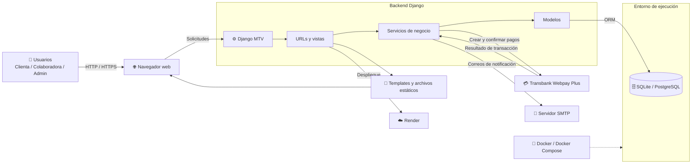

# Nicolett Studio Fantasy

<div align="center">
  
</div>

> [!NOTE]
> Plataforma web desarrollada para digitalizar la gestión del salón, simplificar la reserva de servicios y mejorar la experiencia de clientas y colaboradores.

<p align="center">
  <a href="https://nicolett-studio-fantasy.onrender.com/" target="_blank" rel="noopener noreferrer">
    
  </a>
  <a href="https://github.com/DannyForever/nicolett-studio-fantasy" target="_blank" rel="noopener noreferrer">
    
  </a>
</p>

<p align="center">
  <a href="https://github.com/DannyForever/nicolett-studio-fantasy/stargazers" target="_blank" rel="noopener noreferrer">
    
  </a>
  <a href="https://github.com/DannyForever/nicolett-studio-fantasy/forks" target="_blank" rel="noopener noreferrer">
    
  </a>
  <a href="https://github.com/DannyForever/nicolett-studio-fantasy/issues" target="_blank" rel="noopener noreferrer">
    
  </a>
</p>

<h3 align="center">📊 Estadísticas del repositorio</h3>

<p align="center">
  <a href="https://github.com/DannyForever/nicolett-studio-fantasy" target="_blank" rel="noopener noreferrer">
    
  </a>
</p>

## 📌 1. Descripción del proyecto

**Nicolett Studio Fantasy** es una plataforma integral para un salón de belleza. Permite explorar servicios, gestionar citas, administrar el catálogo, llevar ventas y pagos, recibir recordatorios y atender a usuarios con distintos niveles de acceso desde una sola solución.

<div align="center">
  
  &nbsp;&nbsp;
  
</div>

### 👥 ¿A quién está dirigida?

| Perfil | Necesidad principal | Funcionalidad destacada |
| --- | --- | --- |
| Propietaria y administradoras | Centralizar la operación del salón | Dashboard, agenda, servicios, personal y reportes |
| Estilistas y profesionales | Organizar citas y atención diaria | Agenda personal, citas compartidas y configuración |
| Clientas | Agendar y consultar servicios fácilmente | Catálogo, carrito, pago seguro y historial |
| Visitantes | Conocer la oferta del salón | Servicios, galería, información y contacto |

### 🎯 Problemas que resuelve

- Evita la gestión de citas mediante llamadas, mensajes y hojas de cálculo dispersas.
- Reduce conflictos de horario y facilita la coordinación entre profesionales.
- Centraliza el catálogo de servicios y productos en un único sistema.
- Mantiene disponibles los datos de ventas, citas y perfiles para cada rol.
- Simplifica el proceso de pago en línea y la consulta del estado de las compras.

> [!TIP]
> Las funciones disponibles varían según el perfil del usuario: visitante, clienta, colaboradora o administradora.

## 🛠️ 2. Tecnologías utilizadas

<p align="center">
  
</p>

<p align="center">
  Pagos en línea con <strong>Transbank Webpay Plus</strong>
</p>

> [!IMPORTANT]
> SQLite se utiliza como opción predeterminada para desarrollo. PostgreSQL puede configurarse mediante `DATABASE_URL` en entornos que requieren una base de datos administrada.

## 🚀 3. Ejecución y despliegue

La plataforma está desplegada en Render y se puede visitar en [nicolett-studio-fantasy.onrender.com](https://nicolett-studio-fantasy.onrender.com/).

Las siguientes instrucciones permiten ejecutar una instancia localmente, ya sea con Docker o directamente en un entorno Python. La ruta de ejemplo corresponde a la ubicación del proyecto Django dentro de este repositorio.

### 🐳 Con Docker

1. Instala y abre Docker Desktop.
2. Desde una terminal en la raíz del repositorio, entra a la carpeta del proyecto Django:

   ```powershell
   cd "Fase 2\Evidencias Proyecto\Nicolett Studio Fantasy"
   ```

3. Si aún no tienes un archivo `.env`, créalo a partir de la plantilla:

   ```powershell
   Copy-Item .env.example .env
   ```

4. Construye la imagen e inicia los servicios:

   ```powershell
   docker compose up --build
   ```

5. Cuando el contenedor esté listo, abre `http://localhost:8000` en el navegador.

Para detener la aplicación, presiona `Ctrl+C` y ejecuta:

```powershell
docker compose down
```

### 🧰 Sin Docker

1. Asegúrate de tener Python instalado. Desde una terminal en la raíz del repositorio, entra a la carpeta del proyecto Django:

   ```powershell
   cd "Fase 2\Evidencias Proyecto\Nicolett Studio Fantasy"
   ```

2. Crea y activa un entorno virtual, instala las dependencias e inicializa la base de datos:

   ```powershell
   python -m venv venv
   venv\Scripts\activate
   pip install -r requirements.txt
   python manage.py migrate
   ```

3. Inicia el servidor de desarrollo:

   ```powershell
   python manage.py runserver
   ```

4. Accede a `http://127.0.0.1:8000`.

> [!NOTE]
> El servidor de Django iniciado con `runserver` está pensado para desarrollo local. La versión publicada del proyecto está disponible en [Render](https://nicolett-studio-fantasy.onrender.com/).

> [!WARNING]
> No subas al repositorio archivos `.env` ni credenciales reales de correo, base de datos o pagos.

<details>
<summary><strong>📧 Configuración de correo electrónico</strong></summary>

Para enviar comprobantes por correo, configura `EMAIL_HOST_USER` y `EMAIL_HOST_PASSWORD` en el archivo `.env` utilizando una cuenta SMTP y una contraseña de aplicación.

Si las variables quedan vacías, Django utilizará el backend de consola local y el correo se mostrará únicamente en el terminal.

</details>

<details>
<summary><strong>💳 Configuración de pagos con Transbank</strong></summary>

Por defecto, Webpay Plus se ejecuta en modo de integración:

```env
TRANSBANK_ENVIRONMENT=INTEGRATION
```

Para producción se deben configurar además, en `.env` o en las variables seguras del despliegue:

- `TRANSBANK_COMMERCE_CODE`
- `TRANSBANK_API_KEY`
- `TRANSBANK_RETURN_URL` con una dirección pública HTTPS

La aplicación registra una compra únicamente después de confirmar su estado con Transbank. Los datos de tarjeta se ingresan exclusivamente en la página segura de Webpay.

</details>

<details>
<summary><strong>🗄️ Persistencia y despliegue con Docker</strong></summary>

Docker ejecuta las migraciones al iniciar y conserva SQLite y los archivos subidos mediante volúmenes persistentes. Estos datos son independientes de una base local o de la instancia desplegada en Render.

Para actualizar la aplicación desde GitHub:

```powershell
git pull origin main
cd "Fase 2\Evidencias Proyecto\Nicolett Studio Fantasy"
docker compose up --build -d
```

> [!CAUTION]
> No uses `docker compose down -v` si deseas conservar la base de datos y los archivos cargados.

</details>

## 🏗️ 4. Arquitectura de la solución

La solución sigue una arquitectura cliente-servidor basada en el patrón **Model-Template-View (MTV)** de Django.



### 🔄 Flujo principal

1. El usuario accede desde un navegador y selecciona un servicio o una acción del sistema.
2. Django recibe la solicitud a través de las rutas y ejecuta la vista correspondiente.
3. Los modelos consultan o modifican los datos mediante el ORM.
4. La base de datos devuelve la información necesaria.
5. Los templates generan la respuesta que se muestra en el navegador.
6. Los servicios de pago y correo se integran de forma externa cuando la operación lo requiere.

### 🧩 Módulos principales

| Módulo | Responsabilidad |
| --- | --- |
| `usuarios` | Registro, autenticación y perfiles |
| `agenda` | Citas, disponibilidad y calendario |
| `catalogo` | Servicios y productos disponibles |
| `carrito` y `pagos` | Selección de productos y pago Webpay |
| `ventas` | Registro y seguimiento de compras |
| `panel_admin` | Administración, reportes y configuración |
| `notificaciones` | Recordatorios y comunicaciones |
| `fichas` | Información asociada a la atención |

## 📐 5. Requerimientos no funcionales

Los requerimientos no funcionales (RNF) definen **cómo debe funcionar** la plataforma: su seguridad, velocidad, disponibilidad y facilidad de uso, además de las funciones que ofrece. La matriz de requerimientos del proyecto establece las siguientes metas y su impacto:

| Requerimiento | Meta definida en la matriz | Impacto en el proyecto y por qué importa |
| --- | --- | --- |
| Seguridad y acceso por roles | Proteger credenciales y restringir vistas administrativas según permisos. | Reduce el riesgo de exposición de datos y evita que una clienta acceda a operaciones internas. |
| Rendimiento | Cargar páginas principales y consultar horarios en menos de **2 segundos**. | Una agenda ágil disminuye abandonos y facilita reservar desde el teléfono. |
| Disponibilidad | Objetivo superior al **99 %** de tiempo operativo. | Permite consultar servicios y agendar sin depender del horario de atención del salón. |
| Concurrencia e integridad | Evitar que dos clientas confirmen el mismo bloque horario. | Mantiene una agenda confiable y previene dobles reservas y trabajo de corrección. |
| Escalabilidad y carga | Considerar al menos **50 usuarias concurrentes** como meta de carga. | Ayuda a que campañas o fechas de alta demanda no degraden la experiencia; requiere pruebas de carga para comprobarlo. |
| Usabilidad, accesibilidad y compatibilidad | Interfaz adaptable a móviles y escritorio; validar Chrome, Safari, Firefox y Edge. | Facilita el uso por clientas con distintos dispositivos y reduce barreras para completar una reserva. |
| Portabilidad y mantenibilidad | Ejecutar con Docker y mantener módulos de código organizados. | Simplifica la preparación de entornos y hace más seguro corregir o ampliar funcionalidades. |
| Respaldo y recuperación | La matriz propone respaldos diarios y un RTO menor a **2 horas**. | Los volúmenes persistentes ayudan a conservar datos, pero no sustituyen un respaldo externo ni prueban un tiempo de recuperación. |
| Privacidad | Tratar datos personales de acuerdo con la normativa chilena aplicable. | Protege la confianza de clientas y profesionales y orienta la recolección, uso y conservación de sus datos. |
| Configuración regional | Usar CLP y la zona horaria `America/Santiago`, con formatos locales. | Evita errores en precios, disponibilidad de horas y lectura de fechas. |
| Integraciones externas | Informar fallos de servicios como la pasarela de pago sin interrumpir todo el sitio. | Permite orientar a la clienta cuando un tercero está temporalmente indisponible. |

> [!IMPORTANT]
> Las metas numéricas provienen de `Requerimientos.xlsx`. La matriz registra estos RNF como pendientes; por ello son **objetivos definidos**, no resultados de rendimiento, disponibilidad, carga o recuperación ya certificados. Deben verificarse y actualizarse con pruebas y evidencia antes de presentarlos como cumplidos.

## 🔐 6. Protección de datos y seguridad

La aplicación maneja datos de cuentas, citas, perfiles y compras, por lo que la seguridad es parte central de la experiencia. Entre los controles presentes en el proyecto se encuentran:

- **Autenticación y contraseñas:** Django valida las contraseñas y las guarda mediante su mecanismo de hash, no como texto legible.
- **Permisos por rol:** el middleware de acceso restringe las rutas administrativas a usuarios autenticados y autorizados; los permisos se verifican en el servidor.
- **Protección de solicitudes:** el proyecto habilita middleware de protección CSRF y contra clickjacking de Django.
- **Conexión y pagos:** el sitio publicado utiliza HTTPS. El ingreso de datos de tarjeta se realiza en la página segura de Transbank; la aplicación inicia y verifica el estado de la transacción.
- **Credenciales de servicios:** claves, contraseñas SMTP y credenciales de producción deben configurarse como variables de entorno en Render o en un `.env` local. El archivo `.env` no se debe subir al repositorio.
- **Acceso responsable:** compartir únicamente los datos necesarios para la atención y no incluir información real de clientas en capturas, incidencias o pruebas públicas.

> [!WARNING]
> En producción configura `DEBUG=False` y una `SECRET_KEY` privada y robusta mediante variables de entorno. No uses los valores de desarrollo como configuración de despliegue. Los controles anteriores no equivalen a una certificación de cumplimiento legal ni implican cifrado general de la base de datos en reposo.

La privacidad, el consentimiento informado, la conservación de datos y las solicitudes de eliminación deben revisarse con la administración y validarse conforme a la normativa aplicable. La matriz del proyecto los contempla como requisitos; este README no afirma una certificación legal.

## 🧪 7. Pruebas y validación

El proyecto incluye pruebas automatizadas organizadas por módulos Django y evidencias documentales de pruebas. Para ejecutar la suite desde la carpeta del proyecto Django:

```powershell
python manage.py test
```

La validación funcional debe cubrir, entre otros flujos, el registro y acceso según rol, la reserva y gestión de citas, el catálogo, el carrito y la confirmación de pagos. Las metas no funcionales requieren además mediciones específicas —por ejemplo, carga concurrente, tiempos de respuesta, disponibilidad y recuperación desde respaldos—; ejecutar las pruebas funcionales por sí solo no las verifica.

## 👩‍💻 8. Sobre nosotras

Somos las creadoras de **Nicolett Studio Fantasy**. Diseñamos y desarrollamos esta plataforma como proyecto Capstone, combinando análisis, desarrollo web, experiencia de usuario y pruebas.

<table align="center">
  <tr>
    <td align="center" width="50%">
      <br>
      <strong>Daniela Huaiquiñir</strong><br>
      <sub>Scrum Master · líder técnica · desarrolladora full stack</sub><br><br>
      <a href="https://www.linkedin.com/in/daniela-huaiquinir/" target="_blank" rel="noopener noreferrer">
        
      </a>
    </td>
    <td align="center" width="50%">
      <br>
      <strong>Alejandra Garrido</strong><br>
      <sub>Análisis de requerimientos · gestión del proyecto · desarrollo</sub><br><br>
      <a href="https://www.linkedin.com/in/alejandra-garrido05/" target="_blank" rel="noopener noreferrer">
        
      </a>
    </td>
  </tr>
</table>

## 🔁 9. Metodología de trabajo: Scrum

El equipo seleccionó **Scrum** porque permite entregar funcionalidades en incrementos, recibir retroalimentación de la administración del salón y ajustar prioridades a medida que se valida la plataforma. La metodología del equipo trabaja con **sprints de cuatro semanas**.

| Práctica o artefacto | Cómo se aplica al proyecto |
| --- | --- |
| Product Backlog | Reúne y prioriza historias y requerimientos junto con la dueña del producto. |
| Sprint Planning y Sprint Backlog | El equipo selecciona y estima el trabajo que abordará durante la iteración. |
| Desarrollo y pruebas | Se construyen incrementos funcionales de agenda, perfiles, catálogo, pagos y administración, con validación de calidad. |
| Sprint Review | Se demuestra el incremento a la administración para recoger comentarios y validar el resultado. |
| Sprint Retrospective | El equipo identifica aprendizajes y acciones de mejora para la siguiente iteración. |

Las evidencias del proyecto incluyen backlog, planificaciones de Sprint, revisiones y retrospectivas. El Scrum Master facilita la organización y el seguimiento; el Product Owner prioriza el valor del producto, y el equipo de desarrollo diseña, implementa y valida los incrementos.

---

<div align="center">

**Nicolett Studio Fantasy** · Belleza a tu ritmo y sin barreras

</div>
